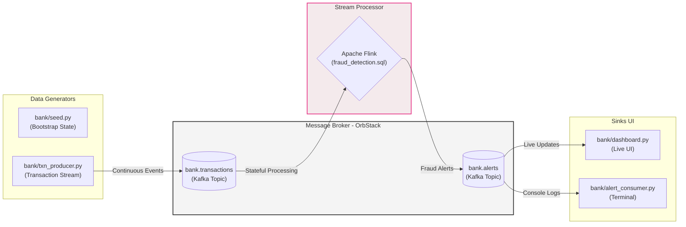

# Demo Bank: Event-Driven Fraud Detection Architecture (Kafka + Flink)

This project is a demonstration of a real-time event streaming and complex event processing (CEP) architecture. It simulates a retail bank's transaction stream, detecting fraud in real-time with Apache Flink, and visualizing the results via a web dashboard.

As a platform engineer, this project illustrates the core patterns of moving from batch processing to streaming architectures, handling stateful real-time computations, and managing distributed messaging systems.

## Architecture & Data Flow

The system operates on an event-driven architecture, decoupling data producers from consumers.



1. **Producer (`txn_producer.py`)**: Continuously pushes dummy transaction events to Kafka. This represents upstream microservices handling user actions.
2. **Message Broker (Kafka)**: Acts as the central nervous system. Running Confluent Platform in Kubernetes (OrbStack), providing high throughput, fault tolerance, and log replayability.
3. **Stream Processor (Apache Flink)**: A local Dockerized cluster that subscribes to the `bank.transactions` topic. It executes a continuous SQL query to detect anomalous patterns, statefully, and emits results to the `bank.alerts` topic.
4. **Consumers (`dashboard.py`, `alert_consumer.py`)**: Downstream applications reacting to the alerts and transactions in real-time.

## The Stream Processing Logic (Flink SQL)

The core business logic resides in `flink/sql/fraud_detection.sql`. It demonstrates stateful stream processing, a step up from simple stateless filtering.

One Flink job executes three distinct rules. They are submitted together in a `STATEMENT SET` to optimize reads, ensuring the `bank.transactions` topic is scanned only once for all three queries.

| Rule | Severity | Flink Feature & Engineering Concept |
|---|---|---|
| `LARGE_TRANSACTION` | HIGH/CRITICAL | **Stateless Filter**: Simple threshold checks (txns > 10k). Fast, requires no state memory. |
| `VELOCITY` | MEDIUM | **Tumbling Window (`TUMBLE`)**: Stateful aggregation. Groups events by a fixed 1-minute time window per account. Demonstrates handling temporal bursts. |
| `IMPOSSIBLE_TRAVEL` | CRITICAL | **Complex Event Processing (`MATCH_RECOGNIZE`)**: Pattern matching across ordered events. Detects consecutive transactions in different countries within 5 mins. |

### Engineering Considerations in the SQL:

- **`MATCH_RECOGNIZE` vs. Interval Joins**: `IMPOSSIBLE_TRAVEL` uses `MATCH_RECOGNIZE`. If we used an interval join, every foreign charge would pair with *every* subsequent home charge within the window, causing an O(N^2) explosion of duplicate alerts. `PATTERN (HOME AWAY)` ensures we only compare adjacent events, keeping state memory and output minimal.
- **`'scan.startup.mode' = 'latest-offset'`**: Configured to process only new messages. Critical for avoiding alert storms on job restarts when dealing with historical data.
- **`table.exec.source.idle-timeout = 10s`**: Crucial for windowed operations in low-traffic scenarios. If a Kafka partition receives no data, its watermark doesn't advance. This setting forces idle partitions to advance their watermarks based on system time, preventing event-time windows from stalling indefinitely.

## Running the Platform Locally

Prerequisites: Python 3, Docker, and an OrbStack Kubernetes cluster running Confluent Platform. Note that OrbStack resolves `*.svc.cluster.local` natively, eliminating the need for manual port-forwarding between the host and containers.

```bash
# 0. Setup Environment
.venv/bin/pip install -r requirements.txt

# 1. Bootstrap State (Customers/Accounts)
.venv/bin/python -m bank.seed --show

# 2. Provision Infrastructure (Kafka Topics)
# Note: auto-create is disabled to enforce schema and partition planning
.venv/bin/python -m bank.topics

# 3. Deploy Stream Processor (Flink) & Submit Job
# Flink UI available at: http://localhost:8081
docker compose -f flink/docker-compose.yml up -d
docker compose -f flink/docker-compose.yml exec -T jobmanager \
  ./bin/sql-client.sh -f /opt/sql/fraud_detection.sql

# 4. Start Traffic Generators
# Adjust rates for load testing: --rate 1.0 --fraud-rate 0.10
.venv/bin/python -m bank.txn_producer

# 5. Start Consumers (UI Dashboard)
# View at: http://127.0.0.1:8000
.venv/bin/python -m bank.dashboard
```

*Note on Ordering: The Flink job is configured with `latest-offset`. Start it (Step 3) before generating traffic (Step 4) to ensure you process the live stream.*

## Infrastructure Specs (Kafka)

| Topic | Partitions | Replication Factor | Notes |
|---|---|---|---|
| `bank.transactions` | 3 | 3 | High throughput event stream |
| `bank.alerts` | 3 | 3 | Low throughput, high value analytical output |

Monitoring: Confluent Control Center is accessible at `http://controlcenter.confluent.svc.cluster.local:9021`.

## Teardown

```bash
pkill -f bank.txn_producer
pkill -f bank.dashboard
docker compose -f flink/docker-compose.yml down
```
